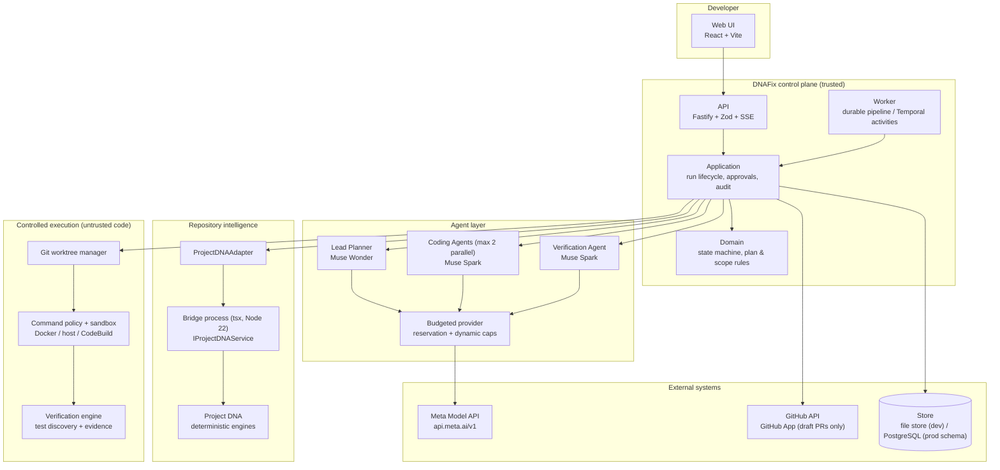
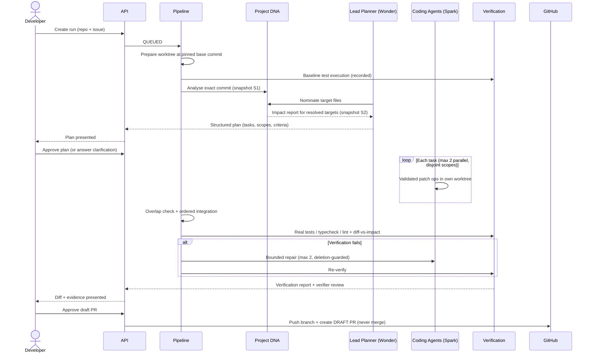
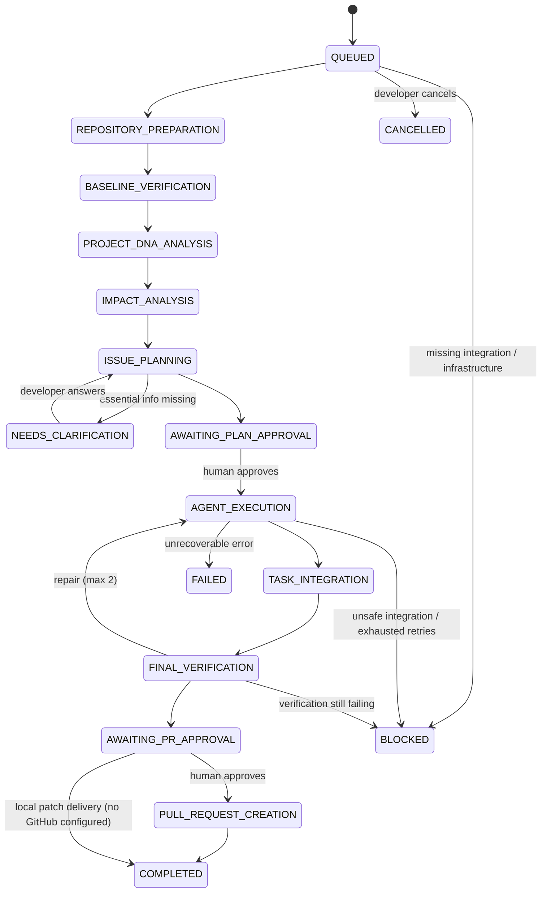
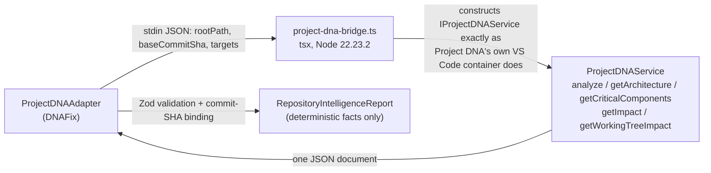
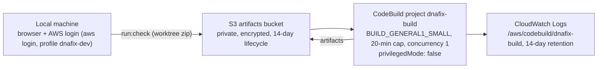

# DNAFix

**Architecture-aware autonomous software engineering system.**

DNAFix transforms a GitHub issue into a verified, human-reviewable draft pull request. It does not start by generating a patch. It first analyses the target repository with a deterministic software-intelligence engine, derives a structural impact assessment bound to an exact commit, plans against that evidence, executes bounded coding tasks in isolated Git worktrees, verifies the result with real test executions, and only then — after explicit human approval — publishes a draft pull request.

> Understand the software before changing the software.

| | |
|---|---|
| Primary intelligence | Meta **Muse Wonder** (`muse-wonder-1.0`) — lead planning, task decomposition, recovery decisions |
| Sub-agent model | Meta **Muse Spark** (`muse-spark-1.3`) — coding and verification agents (cost-optimised, user-approved role split) |
| Repository intelligence | **Project DNA** — deterministic architecture, dependency, risk and structural-impact analysis |
| Backend | Node.js 22, TypeScript, Fastify, Zod, PostgreSQL (schema + migrations), Temporal (workflow definitions) |
| Frontend | React 18, Vite, TypeScript, Tailwind CSS, TanStack Query, React Router |
| Execution | Git worktrees, validated patch operations, argv-allowlist command policy, Docker sandbox or AWS CodeBuild |
| Status | Working end-to-end locally. See [Verification status](#verification-status) for exactly what has and has not been proven. |

---

## Table of contents

- [Why DNAFix exists](#why-dnafix-exists)
- [System architecture](#system-architecture)
- [How a run works](#how-a-run-works)
- [Module map](#module-map)
- [Project DNA integration](#project-dna-integration)
- [Model integration](#model-integration)
- [Agent orchestration and execution safety](#agent-orchestration-and-execution-safety)
- [Verification and repair](#verification-and-repair)
- [GitHub delivery policy](#github-delivery-policy)
- [Data model and persistence](#data-model-and-persistence)
- [API reference](#api-reference)
- [Web application](#web-application)
- [Configuration](#configuration)
- [Getting started](#getting-started)
- [Testing and quality gates](#testing-and-quality-gates)
- [Evaluation: does Project DNA actually help?](#evaluation-does-project-dna-actually-help)
- [AWS remote execution](#aws-remote-execution)
- [Security model](#security-model)
- [Repository structure](#repository-structure)
- [Limitations and explicit non-claims](#limitations-and-explicit-non-claims)
- [Roadmap](#roadmap)
- [Documentation index](#documentation-index)
- [Contributing](#contributing)
- [License](#license)

---

## Why DNAFix exists

General-purpose coding agents typically read an issue, search for a plausible file, and generate a patch. That approach has three structural weaknesses:

1. **No verified repository model.** The agent's beliefs about architecture and dependencies are inferred from whatever files it happened to open. There is no deterministic dependency graph, no impact analysis, and no way to distinguish a verified fact from a plausible guess.
2. **No evidence discipline.** "Tests pass" often means the agent believes they would pass. Success states are asserted, not demonstrated.
3. **Weak change control.** Agents edit a shared working tree with broad shell access, retry without bound, and treat their own output as verified.

DNAFix is built around the opposite chain:

```
Project DNA      provides deterministic software understanding.
Muse Wonder      provides agentic intelligence (planning, delegation, recovery).
Controlled exec  provides safe, bounded implementation.
Verification     provides independent, executable evidence.
GitHub           delivers the result to a human developer for review.
```

Every meaningful claim in the system carries evidence: an affected file has a repository path and an analysis citation; a passing test has a command, an exit code and recorded output; a completed task has a commit; a pull request has a real GitHub URL. DNAFix fails closed (`BLOCKED` / `FAILED`) rather than fabricating missing evidence.

---

## System architecture

DNAFix is a **modular monolith** with separately runnable API, web and worker processes, organised with hexagonal (ports-and-adapters) boundaries. Domain and application layers depend only on ports; GitHub, Meta's Model API, Project DNA, Docker, AWS and PostgreSQL are reached through adapters. See [`docs/ARCHITECTURE.md`](docs/ARCHITECTURE.md) and the ADRs in [`docs/adr/`](docs/adr/).



### Process topology

| Process | Entry point | Responsibility |
|---|---|---|
| `apps/api` | `apps/api/src/index.ts` | REST API, SSE progress streams, OpenAPI docs, approval endpoints |
| `apps/web` | `apps/web/src/App.tsx` | Dashboard, run detail, plan/PR approval UI |
| `apps/worker` | `apps/worker/src/index.ts` | Polls for queued runs (in-process durable engine) or runs a Temporal worker |

### Workflow engines

The lifecycle state machine (`packages/domain`) is the single source of truth. Two executors implement it (ADR-0004):

- **In-process durable engine** (default): every transition and audit event is persisted through the store port before the pipeline advances; supports pause/resume, cancellation and restart recovery.
- **Temporal**: deterministic workflow definitions with signal-based human approvals live in `apps/worker/src/temporal-workflows.ts`; all side effects are confined to activities. Enabled with `WORKFLOW_ENGINE=temporal`. Implemented but **not yet executed against a real Temporal server** in this project.

---

## How a run works



### Run lifecycle



Every transition is validated (`canTransition`/`assertTransition`), persisted, and written to an append-only audit log with actor, action, result and evidence.

---

## Module map

| Package | Responsibility | Key public surface |
|---|---|---|
| `packages/contracts` | Zod schemas for every external boundary (API, model I/O, patches, evaluation records) | `PlanGenerationOutputSchema`, `FilePatchOperationSchema`, `EvaluationRunRecordSchema` |
| `packages/domain` | Pure rules: lifecycle transitions, plan validation, scope enforcement, overlap detection | `assertTransition`, `validatePlanSemantics`, `assertOperationsInScope` |
| `packages/application` | Use cases + the durable pipeline (preparation → analysis → planning → execution → integration → verification → delivery) | `Pipeline`, `RunService`, `buildPrBody` |
| `packages/model-provider` | Meta Model API transport, structured outputs, budget enforcement | `MetaModelProvider`, `BudgetedModelProvider`, `ModelProvider` (port) |
| `packages/repository-intelligence` | `RepositoryIntelligence` port + Project DNA bridge adapter | `ProjectDNAAdapter` |
| `packages/git-engine` | Worktree lifecycle, diff/commit/integration, validated reuse, safe resets | `GitWorktreeManager.createOrReuseWorktree` |
| `packages/execution` | Command allowlist policy, environment scrubbing, host/Docker runners | `validateArgv`, `HostCommandRunner`, `DockerCommandRunner` |
| `packages/verification` | Test discovery from `package.json`, baseline vs final runs, diff-vs-impact comparison | `discoverChecks`, `runChecks`, `compareImpact` |
| `packages/agent-orchestrator` | Scope-enforced patch application (deny-by-default deletions), coding/verifier agents | `applyPatchOperations`, `CodingAgent` |
| `packages/github` | GitHub App JWT auth, user OAuth + installation/repository/issue integration (token encryption, ETag cache, pagination), issue/PR REST adapter, webhook HMAC | `GitHubIntegrationService`, `GitHubAdapter` (draft PR only; no merge method exists) |
| `packages/persistence` | Store port; JSON file store (dev), memory store (tests), PostgreSQL Drizzle schema + migration | `Store`, `FileStore` |
| `packages/remote-execution` | Remote execution port + AWS CodeBuild adapter (CLI-based; no AWS SDK coupling) | `RemoteExecutionProvider`, `CodeBuildExecutionProvider` |

Dependency direction is strictly inward: apps → application → domain/contracts → ports. No domain code imports Fastify, GitHub, Meta, Docker, AWS or Project DNA types.

---

## Project DNA integration

Project DNA is a separate, independently maintained monorepo ([`dinitheth/Project-DNA`](https://github.com/dinitheth/Project-DNA)). DNAFix **does not** vendor it, modify it, or reimplement any of its engines (in particular, there is no second ImpactEngine). Integration is an out-of-process bridge (ADR-0002):



Facts enforced by the adapter:

- Analysis is bound to an exact commit: the bridge runs `git rev-parse HEAD` in the analysed worktree and the adapter rejects results whose commit differs from the run's pinned base commit. Stale impact data is never reused.
- The report preserves Project DNA's own completeness flags, truncation records, bounds and warnings verbatim. If Project DNA reports incomplete results, the UI says so; DNAFix never upgrades a partial result to a "complete blast radius".
- Model hypotheses are stored separately from deterministic facts (`source: "project-dna" | "model-hypothesis" | "diff"` on every affected path).
- If `PROJECT_DNA_PATH` is unset or the bridge fails, the run becomes `BLOCKED` with the exact error. There is no simulated fallback analysis.

Two snapshots are produced per planning cycle and both are recorded: the planning-stage snapshot (full analysis) and the impact-stage snapshot (targeted `getImpact` results for model-nominated, repository-resolved targets).

**Verified live**: the bridge analysed the fixture repositories at pinned commits and `getImpact("src/discount.ts")` surfaced the real dependent (`src/cart.ts`); automated in `tests/integration/project-dna-bridge.test.ts` (runs when `PROJECT_DNA_PATH` is set).

---

## Model integration

### Roles

| Role | Model (default) | Responsibilities |
|---|---|---|
| Lead Planner | Muse Wonder `muse-wonder-1.0` | Issue analysis, task decomposition, delegation, replanning, recovery |
| Coding Agent | Muse Spark `muse-spark-1.3` | One bounded task per worktree; validated patch operations only |
| Verification Agent | Muse Spark `muse-spark-1.3` | Read-only review of diff + test evidence (deterministic runner stays authoritative) |

The split is explicit configuration (`MUSE_WONDER_MODEL`, `MUSE_SPARK_MODEL`), recorded in every run record, and was adopted by user decision after live cost measurement (identical smoke prompt: Wonder 21,873 tokens vs Spark 4,558). Evaluation experiments pin a single model across all roles for comparability. There is no silent model downgrade anywhere in the codebase.

### Transport

Verified against Meta's documentation (Models, Protocols, Responses, Structured Output):

- Endpoint: `POST https://api.meta.ai/v1/responses` (`MODEL_TRANSPORT=chat-completions` selects the Chat Completions equivalent behind the same port).
- Structured output: `text.format = { type: "json_schema", name, schema }` (Responses) — JSON Schema generated from the Zod contracts with `zod-to-json-schema`.
- Every response envelope and every structured payload is validated locally with Zod before use. Invalid model output is a recorded failure, never coerced.
- The provider is a typed `fetch` implementation. The OpenAI SDK (inspected at 4.104.0) was removed after its parse-helper typing proved unreliable against Meta's format surface; no unsafe casts remain.
- Secrets are read from the environment only, never logged, and never included in prompts.

**Verified live**: `pnpm model:smoke` (exit 0) for both models, and a complete live pipeline run — plan → human approval → patch → tests passed → verifier approve → human PR approval → `COMPLETED` (run `run_335bd754-004`).

### Budget enforcement

`BudgetedModelProvider` wraps all experiment traffic with:

- **Pre-request reservation**: estimates input cost (chars/3) and reserves the worst-case output cost before any request is sent.
- **Dynamic output caps**: each request's `max_output_tokens` is computed from the remaining monetary and token budgets (`min(configured cap, by-cost, by-tokens)`), refusing the request unsent when the cap would be uselessly small.
- **Hard ceilings**: per-arm call, token (250,000) and monetary ($3 in the evaluation profile) limits, enforced again on measured usage after every response.
- **Incomplete-response accounting**: usage is read from the provider immediately after envelope validation, so `status: incomplete` responses (with `incomplete_details.reason`) still account for real spend.

---

## Agent orchestration and execution safety

### Patch contract (the model never gets a shell)

Models return structured patch operations — `create`, `replace` (exact-anchor, must match exactly once, line-ending tolerant), `delete` — validated against the task contract before anything touches disk:

- Paths are normalised and confined to the assigned worktree (symlink-aware containment checks).
- Every operation path must be inside the task's declared file scope.
- **Deletion is deny-by-default**: a delete is permitted only for exact paths listed in the task's `approvedDeletions`, which a human approves as part of the implementation plan. Repair tasks carry no approved deletions, so repairs cannot delete files. (Added after evaluation pilot eval-v1 observed a repair patch deleting a core source file; covered by unit + pipeline integration tests asserting rejected repairs are audited and never committed.)

### Worktrees

- One worktree per task, created from the pinned base commit on a deterministic branch (`dnafix/<run>/<task>`); at most two coding agents run concurrently, and only with disjoint file scopes and no dependency relationship.
- Reuse is validated, never assumed: `createOrReuseWorktree` verifies the managed path, registration in `git worktree list --porcelain`, expected branch/ownership and a verifiable HEAD. Unexpected git errors propagate.
- Retries reset reused worktrees to the pinned base (`reset --hard` + `clean -fd`), restricted to DNAFix-managed paths, so a failed attempt cannot contaminate the next.
- Integration re-checks overlapping changed paths across tasks, cherry-picks in dependency order, aborts on conflict, and never force-merges.

### Command execution

- Argv arrays only (`shell: false`; validated Windows `.cmd` shim handling in host mode). Allowlisted executables (`node`, `pnpm`, `npm`, `npx`, read-only `git` subcommands); shell metacharacters in arguments are rejected.
- Environment is scrubbed to an allowlist — no `MODEL_API_KEY`, GitHub credentials, or host secrets reach executed code.
- Timeouts and output caps on every command; every result records argv, cwd, exit code, duration and output summary.

### Sandbox modes

| Mode | Isolation | Status |
|---|---|---|
| `SANDBOX_MODE=docker` | `docker run --network none --cap-drop ALL --security-opt no-new-privileges --read-only`, non-root, worktree-only mount, memory/CPU limits | Implemented; fails closed when the daemon is unavailable. Not executed in the current dev environment (no local Docker, by user choice). |
| `SANDBOX_MODE=host` | Process-level only | Development use. Explicitly recorded as reduced isolation in every verification report it touches. **Only acceptable for trusted, DNAFix-authored fixture code — never for arbitrary external repositories.** |
| AWS CodeBuild | Managed cloud build environment | Provider implemented and provisioned; execution currently quota-blocked (see [AWS remote execution](#aws-remote-execution)). |

---

## Verification and repair

1. **Before coding**: test/typecheck/lint commands are discovered from the repository's `package.json`; baseline results are recorded so pre-existing failures are distinguishable from regressions.
2. **After coding**: full diff inspection, diff-vs-predicted-impact comparison (matched / unexpected / predicted-but-unchanged), and real execution of discovered checks. Statuses distinguish `passed`, `failed`, `skipped`, `not-executed`, `blocked`, `pre-existing-failure`.
3. **Independent verifier**: reviews the diff, acceptance criteria and *actual* check results. The deterministic runner — not the verifier, and never the coding agent — is the authority on test outcomes.
4. **Bounded repair**: failures produce a targeted repair task (failure output included), applied in the integration worktree under the deletion guard, then re-verified. Maximum 2 attempts (`MAX_REPAIR_ATTEMPTS`); on exhaustion the run is `BLOCKED` with the failing evidence, never silently "completed".

---

## GitHub delivery policy

**Source integration.** DNAFix can connect a GitHub account through a GitHub App, discover the App installations the account can access, browse and search their repositories, and read or search real issues. Selecting an issue imports its exact title, Markdown body and number into the New Analysis form; the run keeps the issue URL and installation as provenance, and the backend re-validates both before accepting the run. Tokens never reach the browser: user/refresh tokens are encrypted at rest with AES-256-GCM, installation tokens are cached in API memory only, and OAuth state is single-use, short-lived and bound to an HttpOnly session cookie. Setup, permissions and environment values are documented in [`docs/GITHUB_APP_SETUP.md`](docs/GITHUB_APP_SETUP.md).

The live connection/import path is **implemented but not yet verified against GitHub**, because no App credentials are configured in this environment. Units and API routes are tested with mocked GitHub responses only.

**Delivery.** The following applies to the separate draft-PR path:

- GitHub App authentication (RS256 JWT → short-lived installation tokens); webhook payloads are HMAC-SHA256 verified with constant-time comparison.
- Branch publication and draft-PR creation happen **only** after an explicit recorded human approval, using a generated branch name (`dnafix/<run>/integration`) and an idempotency record.
- The adapter always creates **draft** pull requests and exposes **no merge capability at all**. DNAFix never pushes to a default branch and never closes the originating issue.
- Generated PR bodies include: issue reference, implementation summary per task, files changed, the Project DNA impact report with completeness/warnings, executed test commands with actual exit codes, verifier verdict, repair attempts, and known risks.
- When GitHub is not configured, a verified run completes as **local patch delivery** (diff stored on the run, `pullRequestUrl: null`) — recorded honestly, never presented as a PR.

---

## Data model and persistence

The `Store` port abstracts persistence. The local default is an atomic JSON file store (single-user development); a memory store backs tests. The production relational model is defined in `packages/persistence/migrations/0001_initial.sql` (apply with `pnpm db:migrate` when `DATABASE_URL` and the `pg` driver are present) covering: users, GitHub installations, repositories, workflow runs, analysis snapshots, impact reports, implementation plans, agent tasks/sessions, tool invocations, worktrees, verification runs, pull requests, audit events and user approvals — with foreign keys, indexes, lifecycle fields and idempotency keys. The PostgreSQL adapter itself is not yet wired (see Limitations).

Audit events are append-only: `id, runId, repositoryId, actor (user | lead-planner | coding-agent | verification-agent | system), action, result, evidence, createdAt`. SSE progress (`GET /api/v1/runs/:id/events`) replays persisted audit events with `Last-Event-ID` reconnect support.

---

## API reference

Base path `/api/v1`. OpenAPI UI is served at `/docs`. When `DNAFIX_SESSION_TOKEN` is set, all non-webhook routes require `Authorization: Bearer <token>`.

| Method | Route | Purpose |
|---|---|---|
| GET | `/health` | Liveness |
| GET | `/api/v1/config/status` | Integration status (model, Project DNA, GitHub, sandbox, workflow engine) — honest configured/untested flags |
| GET | `/api/v1/repositories` | Connected repositories |
| POST | `/api/v1/runs` | Create a run (local path or GitHub owner/repo + issue) |
| GET | `/api/v1/runs` · `/api/v1/runs/:id` | List / fetch runs (repository-boundary checked) |
| POST | `/api/v1/runs/:id/approve-plan` | Human plan approval → execution |
| POST | `/api/v1/runs/:id/approve-pr` | Human PR approval → draft PR or local delivery |
| POST | `/api/v1/runs/:id/clarification` | Answer a clarification request |
| POST | `/api/v1/runs/:id/cancel` | Cancel a run |
| GET | `/api/v1/runs/:id/diff` | Changed paths + full diff |
| GET | `/api/v1/runs/:id/verification` | Baseline/final checks + verifier review |
| GET | `/api/v1/runs/:id/events` | SSE audit/state stream |
| GET | `/api/v1/audit?runId=` | Audit history |
| POST | `/api/v1/webhooks/github` | GitHub webhooks (HMAC-verified before parsing) |

All request/response bodies are Zod-validated; schemas live in `packages/contracts`.

### GitHub App integration routes

These routes are registered whether or not the App is configured; unconfigured routes fail with `503 not_configured` rather than pretending to connect.

| Method | Route | Purpose |
|---|---|---|
| GET | `/api/v1/integrations/github/status` | Configuration, connection, account and installation state |
| POST | `/api/v1/integrations/github/connect` | Begin user authorization (returns the GitHub authorize URL) |
| GET | `/api/v1/integrations/github/callback` | Single-use OAuth callback; stores encrypted tokens |
| GET | `/api/v1/integrations/github/setup` | Post-install return target |
| GET | `/api/v1/integrations/github/installations` | List accessible App installations |
| POST | `/api/v1/integrations/github/installations/start` | Begin App installation (returns the install URL) |
| POST | `/api/v1/integrations/github/installations/select` | Select an accessible installation |
| GET | `/api/v1/integrations/github/repositories` | Paged, searchable authorized repositories |
| POST | `/api/v1/integrations/github/repositories/select` | Validate and select a repository |
| GET | `/api/v1/integrations/github/repositories/:owner/:repo/issues` | Issue search/list (pull requests excluded) |
| GET | `/api/v1/integrations/github/repositories/:owner/:repo/issues/:number` | Full issue detail with ETag revalidation |
| POST | `/api/v1/integrations/github/refresh` | Refresh tokens/connection metadata |
| POST | `/api/v1/integrations/github/disconnect` | Revoke the grant/installation token and delete the record |

The exact path shapes are defined in `apps/api/src/github.ts`; session cookies are `HttpOnly`, `SameSite=Lax`, `Secure` on HTTPS origins, and tokens are never included in responses.

---

## Web application

React + Vite + Tailwind + TanStack Query + React Router. Screens: run dashboard with live integration-status banners (unconfigured integrations are labelled, never hidden), repository list, issue submission with a progressive GitHub source panel (connect → installation → repository → issue, or manual entry), run detail with Project DNA evidence (including completeness/truncation warnings), issue analysis, implementation plan with approval action, clarification answering, agent task execution, verification evidence with the actual diff, PR approval, draft-PR link, and the full audit history. The dashboard renders real backend state only — there are no mock counters or simulated activity anywhere in the product path.

---

## Configuration

Copy `.env.example` to `.env`. No real secrets are ever committed; `.env` is git-ignored.

| Variable | Default | Purpose |
|---|---|---|
| `API_PORT` | `3001` | API listen port |
| `WEB_ORIGIN` | `http://localhost:5173` | CORS origin |
| `DNAFIX_DATA_DIR` | `.data` | Stores, worktrees, artifacts |
| `DNAFIX_SESSION_TOKEN` | *(empty)* | Optional API bearer token (empty = local-only no-auth) |
| `MODEL_API_KEY` | *(required for real runs)* | Meta Model API key (process env only) |
| `MODEL_API_BASE_URL` | `https://api.meta.ai/v1` | Meta API base URL |
| `MUSE_WONDER_MODEL` | `muse-wonder-1.0` | Lead planner model (sent verbatim; never silently downgraded) |
| `MUSE_SPARK_MODEL` | `muse-spark-1.3` | Coding/verification sub-agent model |
| `MODEL_TRANSPORT` | `responses` | `responses` or `chat-completions` |
| `MUSE_REASONING_EFFORT` | *(unset)* | Optional reasoning effort |
| `PROJECT_DNA_PATH` | *(required for analysis)* | Path to a Project DNA checkout (`pnpm install` completed under Node 22.23.2) |
| `GITHUB_APP_ID`, `GITHUB_APP_CLIENT_ID`, `GITHUB_APP_CLIENT_SECRET`, `GITHUB_APP_PRIVATE_KEY_BASE64` (or `GITHUB_APP_PRIVATE_KEY`), `GITHUB_APP_SLUG`, `GITHUB_TOKEN_ENCRYPTION_KEY` | *(optional)* | GitHub App user connection, repository/issue import and draft PRs — see `docs/GITHUB_APP_SETUP.md` |
| `GITHUB_INSTALLATION_ID`, `GITHUB_WEBHOOK_SECRET` | *(optional)* | Optional legacy installation for draft-PR delivery and webhook verification |
| `APP_BASE_URL` | `http://localhost:3001` | Public API origin used to derive OAuth callback/setup URLs |
| `DATABASE_URL` | *(optional)* | PostgreSQL (production persistence) |
| `WORKFLOW_ENGINE` | `in-process` | `in-process` or `temporal` |
| `TEMPORAL_ADDRESS` | *(unset)* | Temporal server (with `docker compose up`) |
| `SANDBOX_MODE` | `docker` | `docker` (fails closed) or `host` (dev only, reduced isolation) |
| `SANDBOX_IMAGE` / `SANDBOX_MEMORY` / `SANDBOX_CPUS` | `node:22-alpine` / `1g` / `1` | Docker sandbox limits |
| `MAX_REPAIR_ATTEMPTS` | `2` | Bounded repair loop |
| `MAX_AGENT_CONCURRENCY` | `2` | Parallel coding agents |
| `AWS_PROFILE` / `AWS_REGION` | `dnafix-dev` / `ap-southeast-2` | Remote execution profile/region |
| `AWS_CODEBUILD_PROJECT` / `AWS_ARTIFACTS_BUCKET` | *(unset)* | Enable the CodeBuild execution provider |

---

## Getting started

### Prerequisites

- Node.js **22.23.2** (pinned in `.nvmrc` and `engines`; Project DNA requires `>=22.23.2 <23`) and pnpm **9.15.4** via corepack
- Git
- Project DNA for repository analysis: vendored as a git submodule at `vendor/Project-DNA` (clone with `--recurse-submodules`, then `pnpm install` inside it under Node 22). DNAFix consumes it only through its public API; no Project DNA source is copied into DNAFix packages.
- Optional: Docker (sandbox/Temporal/Postgres), a Meta API key, a GitHub App

### Install and run

```bash
corepack prepare pnpm@9.15.4 --activate
pnpm install
cp .env.example .env        # set MODEL_API_KEY and PROJECT_DNA_PATH for real runs

pnpm --filter @dnafix/api dev      # API on :3001 (OpenAPI at /docs)
pnpm --filter @dnafix/web dev      # Web UI on :5173
pnpm --filter @dnafix/worker dev   # optional recovery poller
```

Optional infrastructure (PostgreSQL + Temporal + Temporal UI):

```bash
docker compose up -d
# then set WORKFLOW_ENGINE=temporal and TEMPORAL_ADDRESS=localhost:7233
```

### Verify the model integration

```bash
pnpm model:smoke   # requires MODEL_API_KEY; exits 2 with an explicit blocker without one
```

### Offline demonstration (no API keys)

```bash
pnpm fixture:seed   # creates .data/fixture-repo with a real, reproducible bug
pnpm demo:offline   # scripted TEST DOUBLE drives the pipeline (never presented as Muse)
```

The demo proves pipeline mechanics end-to-end (baseline failure → approval gates → scoped worktree patch → real test pass → verification → local patch delivery). With `PROJECT_DNA_PATH` set it uses genuine Project DNA analysis; without it the run blocks at analysis, by design.

---

## Testing and quality gates

```bash
pnpm -r --if-present typecheck
pnpm lint
pnpm -r --if-present build
pnpm test
PROJECT_DNA_PATH=<checkout> pnpm vitest run tests/integration/project-dna-bridge.test.ts
```

Latest verified result (Node 22.23.2, pnpm 9.15.4): typecheck **exit 0**, lint **exit 0**, build **exit 0**, tests **145 passed, 1 skipped** (the Project DNA bridge test, which passes when `PROJECT_DNA_PATH` is set).

| Level | Coverage |
|---|---|
| Unit | Lifecycle transitions, plan/task validation, scope + deletion policy, overlap/parallelism rules, command policy and env scrubbing, budget reservation/dynamic caps |
| Contract | Meta transport request shape + schema rejection + incomplete-response usage (mocked fetch), GitHub webhook HMAC / App JWT / draft-only PR payload (mocked fetch), GitHub App OAuth state/token exchange/refresh, encrypted token storage, repository and issue pagination/ETag handling, disconnect revocation, import overwrite safeguards, Project DNA adapter misconfiguration, CodeBuild provider command construction (fake CLI) |
| Integration | Git worktree lifecycle incl. validated reuse and reset, offline end-to-end pipeline (failing baseline → verified patch → local delivery), repair-deletion guard (audit + never-committed), real Project DNA bridge analysis against a fixture |
| Security-focused | Path traversal/symlink escape, shell metacharacter injection, out-of-scope patches, unapproved deletions, secret scrubbing, invalid webhook signatures |

---

## Evaluation: does Project DNA actually help?

Milestone 2 exists to test DNAFix's central hypothesis with a controlled experiment rather than assume it. Design, frozen ground truth, metrics, limitations and full run artifacts: [`docs/evaluation/`](docs/evaluation/).

- **Conditions**: Baseline (Muse Wonder with git-inspection only — Project DNA never invoked) vs DNA-aware (identical everything, plus real Project DNA evidence). Same prepared repository and base commit, same model for every role, same tools/budgets, randomized order, separate stores/worktrees, hard call/token/monetary budgets.
- **Benchmark**: a labelled synthetic multi-module TypeScript fixture (`tests/fixtures/benchmark-repo`, "promo codes are accepted but silently ignored") with a frozen reference and a hidden acceptance suite (A1–A5) used only for deterministic scoring; patches are blind-reviewed (mapping sealed; reviewer is a different model; deterministic tests are authoritative).

### Results so far (honest summary)

| Pilot | Outcome |
|---|---|
| eval-v1 | **Invalid.** DNA arm blocked in 5.6 s by an environment failure (pruned Project DNA workspace install; repaired and re-verified). Baseline ran and failed; its repair loop deleted a core file — the finding that produced the deletion guard. |
| eval-v1.1 | **Inconclusive.** Both arms planned identically and completed task 1; both failed at task 2 for distinct engineering reasons (dirty retry worktree; 8,192-token output cap starving patch generation). One blind-reviewed task-level signal favored DNA-aware (clean registry-based validation vs baseline's file deletion). |
| eval-v1.2 | Executed with the fixes (validated worktree reset, 16,384 cap, dual snapshot records, deletion allowlist). Results are held for maintainer review and are **not** treated as accepted evidence. |

**No pilot supports a claim that Project DNA improves coding outcomes yet.** A single matched pair cannot establish statistical significance under any outcome. Full analysis: [`docs/evaluation/RESULTS.md`](docs/evaluation/RESULTS.md), [`docs/evaluation/RESULTS-V1.1.md`](docs/evaluation/RESULTS-V1.1.md).

---

## AWS remote execution

DNAFix can execute builds/tests remotely so the local machine needs no Docker or heavy toolchain. The domain never touches AWS SDK types: `RemoteExecutionProvider` (`packages/remote-execution`) is the port; the CodeBuild adapter drives the AWS CLI with a named profile, generates a buildspec from the validated argv array, polls the build, returns status + a CloudWatch log reference + downloaded artifacts, and cleans up uploaded inputs.



Provisioned (user-approved, ap-southeast-2 only, tagged `Project=DNAFix, Ephemeral=true`): the S3 bucket, log group, a least-privilege CodeBuild service role (bucket + log group only) and the CodeBuild project. No EC2, NAT Gateway, RDS or continuously running infrastructure exists. Estimated evaluation-scale cost is under $5 against the project's credits; spend to date is effectively $0 because **no build has executed yet**: CodeBuild concurrency quotas are 0 on this FREE-plan project (`AccountLimitExceededException`), with a quota-increase case open with AWS. Details and the approval record: [`docs/AWS_EXECUTION.md`](docs/AWS_EXECUTION.md).

Agent Toolkit note: AWS skills/MCP were configured per AWS's official setup (toolkit service in us-east-1; all project resources in ap-southeast-2). AWS MCP tools load in a fresh OpenCode session.

---

## Security model

Summary; full document: [`docs/SECURITY.md`](docs/SECURITY.md).

- **Untrusted inputs**: issue text, repository files, READMEs, test/terminal output and model output. Repository instructions cannot override system policy; tool policy is enforced in code, not prompts.
- **Trusted control plane**: API, pipeline, GitHub token handling, bridge invocation. Secrets exist only in process environment; executed code receives a scrubbed environment; coding sandboxes receive no tokens (GitHub push/PR operations stay in the control plane).
- **Model containment**: structured outputs only; scope-checked, worktree-contained, exact-anchor patches; deny-by-default deletions; argv allowlists; bounded retries/repairs; human gates before execution and before any PR.
- **Auditability**: every state transition, tool outcome, approval and rejection lands in the append-only audit log with evidence.
- **Known gaps**: single-user bearer-token auth (no OAuth/multi-user yet); host sandbox is not OS-level isolation; Docker sandbox and Temporal paths implemented but unexecuted in this environment.

---

## Repository structure

```text
dnafix/
├── apps/
│   ├── api/            Fastify API (REST + SSE + OpenAPI)
│   ├── web/            React + Vite dashboard
│   └── worker/         Pipeline poller + Temporal worker/activities
├── packages/
│   ├── contracts/      Zod schemas for all external boundaries
│   ├── domain/         Lifecycle, plan, scope, overlap rules (pure)
│   ├── application/    Use cases + durable pipeline
│   ├── model-provider/ Meta transport, structured outputs, budget provider
│   ├── repository-intelligence/  Project DNA bridge adapter + bridge script
│   ├── git-engine/     Worktrees, diffs, integration, validated reuse
│   ├── execution/      Command policy, host/Docker runners
│   ├── verification/   Test discovery/execution, diff-vs-impact
│   ├── agent-orchestrator/  Scope-enforced patching, coding/verifier agents
│   ├── github/         GitHub App adapter (draft PRs only)
│   ├── persistence/    Store port, file/memory stores, Postgres schema + migrations
│   └── remote-execution/     Remote execution port + CodeBuild adapter
├── tests/
│   ├── fixtures/       sample-repo (discount bug), benchmark-repo (evaluation), benchmark-acceptance (hidden suite)
│   └── integration/    Pipeline, repair guard, Project DNA bridge tests
├── scripts/            demo:offline, model smoke, evaluation harness, rescoring, blind review, remote check
├── docs/               Architecture, security, integration guides, ADRs, evaluation
├── infrastructure/     Sandbox Dockerfile, (Temporal via docker-compose)
├── docker-compose.yml  PostgreSQL + Temporal (optional)
├── AGENTS.md           Project instructions (incl. AWS starter rules)
└── package.json        Workspace scripts (see below)
```

Useful scripts: `pnpm dev`, `pnpm test`, `pnpm typecheck`, `pnpm lint`, `pnpm build`, `pnpm model:smoke`, `pnpm fixture:seed`, `pnpm demo:offline`, `pnpm remote:check <workspace> <argv...>`, `pnpm db:migrate`.

---

<a id="verification-status"></a>
## Verification status

**Verified with recorded evidence**: TypeScript typecheck/lint/build clean; 46 automated tests passing (plus the real-DNA bridge test with `PROJECT_DNA_PATH` set); Muse Wonder and Muse Spark live API calls (structured planning, patch generation, verification review); a complete live issue-to-patch run with human gates; real Project DNA analysis and impact at pinned commits; offline pipeline E2E; the web UI against the live API; AWS authentication, Agent Toolkit setup, and provisioning of the approved remote-execution resources.

**Implemented but not yet verified against real services**: GitHub draft-PR creation (adapter contract-tested with mocked fetch; no GitHub App credentials configured), Docker sandbox execution (daemon unavailable locally by user choice), Temporal execution (no server run yet), PostgreSQL adapter (schema/migration provided; file store is the current runtime), CodeBuild job execution (provisioned; concurrency quota is 0 with a case open).

---

## Limitations and explicit non-claims

- DNAFix does **not** claim Project DNA improves model outcomes; the evaluation to date is invalid/inconclusive (see Evaluation).
- One matched pilot is exploratory, never statistical proof.
- Host-mode execution is for trusted fixture code only.
- Single-user local auth; no multi-tenant isolation.
- The in-process durable engine is the default; Temporal provides the production durability path but is unexercised.
- Local persistence is a JSON file store until the PostgreSQL adapter is wired.
- Project DNA analysis is recomputed for the impact stage (snapshot reuse is a known optimization, not yet implemented).

## Roadmap

1. Wire the PostgreSQL store adapter; run Temporal end-to-end against the compose stack.
2. Execute the first CodeBuild job when the concurrency quota lands; make CodeBuild the default test executor for untrusted repositories.
3. GitHub App installation flow + first real draft PR.
4. Snapshot reuse in the Project DNA bridge (avoid the second full analysis).
5. Evaluation eval-v1.3 with repeated matched pairs on additional benchmark tasks before drawing any conclusion about the differentiator.
6. Multi-user auth (GitHub OAuth) and repository-level permissions.

## Documentation index

- [`docs/ARCHITECTURE.md`](docs/ARCHITECTURE.md) — modules, lifecycle, evidence rules
- [`docs/SECURITY.md`](docs/SECURITY.md) — trust boundaries and controls
- [`docs/INTEGRATION_PROJECT_DNA.md`](docs/INTEGRATION_PROJECT_DNA.md) — bridge design and setup
- [`docs/MODEL_INTEGRATION.md`](docs/MODEL_INTEGRATION.md) — endpoint verification, transport decision
- [`docs/AWS_EXECUTION.md`](docs/AWS_EXECUTION.md) — remote execution proposal, provisioning record, blockers
- [`docs/IMPLEMENTATION_STATUS.md`](docs/IMPLEMENTATION_STATUS.md) — what is verified, blocked, or untested
- [`docs/BUILD_PLAN.md`](docs/BUILD_PLAN.md) — discovery findings and staged plan
- [`docs/adr/`](docs/adr/) — architecture decision records 0001–0005
- [`docs/evaluation/`](docs/evaluation/) — experiment design, frozen benchmark reference, metrics, limitations, results, run artifacts

## Contributing

1. Use Node 22.23.2 + pnpm 9.15.4. Run `pnpm typecheck && pnpm lint && pnpm test` before proposing changes.
2. Preserve the architectural invariants in `AGENTS.md`: hexagonal boundaries, evidence-before-claims, deny-by-default deletions, human approval before draft PRs, no auto-merge, no fabricated results.
3. New external integrations belong behind a port with contract tests; record significant decisions as ADRs in `docs/adr/`.
4. Never commit secrets. `.env`, `.data/`, and worktree contents are git-ignored.

## License

MIT — see [`LICENSE`](LICENSE) if present, or the `license` field in `package.json`.
